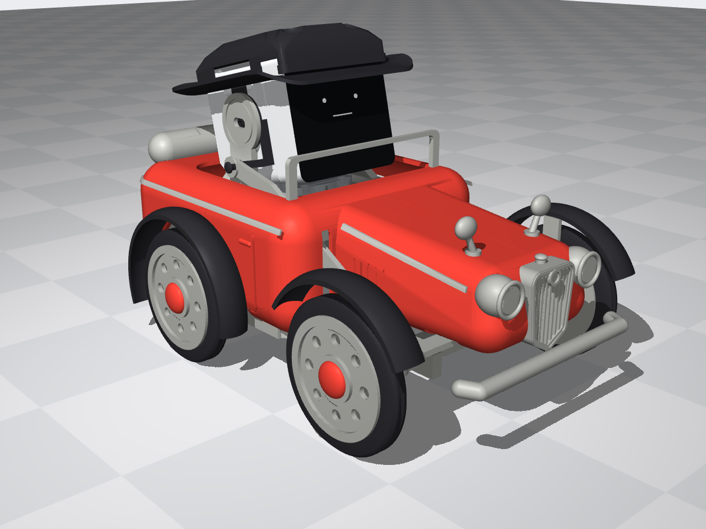

# スタックチャン・レトロカー(改造)

スタックチャンのサーボ 2 個で走る車です。首振りサーボを回し続けて後輪を回し、うなずきサーボで前輪の向きを変えます。
赤いボディに黒いフェンダーとタイヤ、金物はグレー。頭には黒いハットをかぶせ、うなずきをハットの腕から取り出してかじを切ります。

駆動部(デッキ、ターンテーブル歯車、ソケット枠、ピニオン、スリーブ)は [Yeq6X/stackchan-strider](https://github.com/Yeq6X/stackchan-strider)(MIT License)の部品をそのまま使っています。

**実機ではまだ一度も組んでいません。** 形の干渉と、かじ取りの動きの計算までを確かめた段階です。



## 仕様

| 項目 | 値 |
|---|---|
| 大きさ(スタックチャン込み) | 全長 224 × 全幅 142 × 全高 143 mm |
| 質量(見積り) | 約 442 g(印刷部品 約 254 g) |
| 重心の高さ | 地面から約 72 mm。後輪に 84% の重さがかかる |
| 車輪 | 半径 30 mm。前後の車軸の間隔 105 mm |
| 駆動 | 首振りサーボ → 傘歯車(1:1)→ 後輪の六角シャフト |
| かじ取り | うなずき 0〜30° → 前輪 +30〜-30°(13° で直進) |
| 印刷部品 | 55 個(38 種)、PLA 3 色 |

## かじ取りのしくみ


1. **ハットが頭と一緒にうなずく。** ハットは頭に前から差し込み、後ろの止め板で抜けを止めます。
2. **左右の耳当てが位置を決める。** 耳当てはヨークの丸いパッドと同じ中心の円板で、頭とパッドの間に挟まります。中心がうなずきの軸なので、うなずいても位置は変わりません。耳当ての外側の小さな出っぱりが、パッドの長穴に落ちてハットの浮きを止めます。
3. **右の腕のピン J が前後に動く。** J はうなずきの軸の 18 mm 下にあり、うなずくと主に前後へ動きます。
4. **引き棒が右前輪を回す。** J から引き棒で、右前輪のナックルの内向きの腕(ドラッグアーム)を押し引きします。
5. **タイロッドが左前輪も同じ角度で回す。** 左右のナックルの前向きの腕とタイロッドで平行四辺形を作っています。

CoreS3 の横と下はハットで覆っていないので、ボタンや USB に手が届きます。

## 印刷

| ファイル | 中身 |
|---|---|
| `print_car/stackchan_car.3mf` | Bambu Studio のプロジェクト。グレー 3 枚・赤 1 枚・黒 2 枚のプレート |
| `print_car/stl/` | 部品ごとの STL。造形時の向きで置いてある。ファイル名の末尾が個数 |
| `print_car/parts.json` | 部品表(大きさ、体積、張り出しの面積、向き、サポートの要否) |

- **プリンター:** Bambu Lab A1 mini(ベッド 180 mm 角)。プリンターの設定は、元の配布 3MF のものをそのまま使っています。
- **フィラメントの色:** 1 = グレー、2 = 赤、3 = 黒。
- **色ごとの体積:** グレー 223、黒 76、赤 69 cm³。
- **サポートが要る部品:** ナックル、ハット、引き棒、ホイールキャップ、ボディ前後、ボンネットのモール、ミラー、幌、バンパー、ヘッドライト。
- **ホイールはサポートなしで印刷できる見込み。** 皿の下面は、リムとハブの間の幅 11 mm の橋になります。

## 印刷しない部品

| 部品 | 個数 | 用途 |
|---|---|---|
| スタックチャン(CoreS3、サーボ SCS0009 × 2) | 1 | 本体。首振りとうなずきのサーボを使う |
| O リング(太さ 2 mm、内径 55〜57 mm 程度) | 4 | 任意。タイヤの溝にはめて滑り止めにする |
| 接着剤か両面テープ | 少し | ボディや飾りを留める(後述) |

## 組立の順番

1. **駆動部を組む。** ピニオンとスリーブを六角シャフトに通し、左右の側板・デッキを組みます。ターンテーブル歯車とソケット枠も含め、角穴とツメの留め方は walker の吊り下げ版と同じです(`README_UNDERSLUNG.md`)。
2. **後輪を付ける。** タイヤをホイールのつばの間にはめます。ホイールを六角シャフトの端に押し込み、ホイールキャップを差します。六角穴は外寄りの 6 mm だけ軽い圧入です。元の Strider で抜けやすかった点への対策です。
3. **前の横棒とナックルを付ける。** 横棒を側板の前の溝に上から落とします。ナックルのキングピンを横棒のボスに上から通し、下で C クリップを留めます。
4. **タイロッドと前輪を付ける。** タイロッドを左右のナックルの前向きのピンに通し、C クリップで留めます。前輪を軸に差し、ホイールの中で C クリップを留めて、ホイールキャップを差します。
5. **ハットをかぶせる。** スタックチャンを車に載せる前に、頭に前から差し込みます。後ろの止め板を、横の壁の溝へ下から差します。
6. **スタックチャンを載せ、ヨークを留める。** 土台をターンテーブルにはめ、ヨークを上から側板の角穴に留めます。ヨークの腕が少し開いて耳当てを挟み、出っぱりがパッドの長穴に落ちます。
7. **ファームウェアでうなずきを制限する。** 次の「ファームウェア」を参照。引き棒を付ける前に済ませます。
8. **引き棒を付ける。** ハットの腕のピン J とドラッグアームのピンに通し、それぞれ C クリップで留めます。
9. **ボディと飾りを付ける。** ボディ後ろ・前、フェンダー、モール、グリル、ヘッドライト、ミラー、バンパー、風防、幌を付けます。

## ファームウェア

- **首振り:** 回し続けて後輪を回します。使い方は Strider と同じです。
- **うなずきは 0〜30° に必ず制限する。** 元のファームの上限は 60° です。35° で前輪が -38°、45° で -51° まで切れ、引き棒やフェンダーが当たります。
- **直進は約 13°。** 0° で左いっぱい(+30°)、30° で右いっぱい(-30°)です。

## 確認してほしい点

1. **うなずきの軸の高さ。** 実機の写真から、机の面から約 45 mm と読みました(±1.5 mm)。walker の推定値 43 mm より高いです。1.5 mm ずれると、端での切れ角が約 ±5° 変わります。ファームの上限角で合わせてください。
2. **ボディ・フェンダー・飾りの留め方は設計していない。** 今は接着か両面テープの想定です。グリルとヘッドライトはボディの穴に、ミラーは足の棒をボンネットの穴に差し込みます。
3. **前の横棒の上への抜け止めがない。** 溝に落としてあるだけなので、ボディ前で押さえる形が要るかもしれません。
4. **かじの遊び。** ピンと穴のすきま 0.15 mm とハットの横のすきまで、前輪の切れ角に約 ±4.8° の遊びが出る計算です。
5. **前輪にかかる重さは 16%。** 前輪が滑ってかじが効きにくい場合は、O リングを付けてください。
6. **ナックルのピンは寝かせて印刷する。** 丸が少し楕円になるので、C クリップのはまり具合を確かめてください。
7. **ボンネットのモールは細い(0.8 × 2 mm)。** ベッドへの接地が線なので、サポートかブリムを付けてください。
8. **3MF は Bambu Studio で開けるか確かめていない。** 開けない場合は `print_car/stl/` の STL を使ってください。

## 作り直し方

```bash
.venv/bin/python car/verify_car.py
```

```bash
.venv/bin/python car/render_car.py
```

```bash
.venv/bin/python car/build_car.py
```

| スクリプト | 内容 |
|---|---|
| `car/car_design.py` | 形。座標は Strider と同じ(X = 右、Y = 前、Z = 上、原点は後輪の車軸) |
| `car/verify_car.py` | 部品どうしの干渉(車軸 1 周 × うなずき 0〜30°)、質量、重心 |
| `car/render_car.py` | MuJoCo で描いた画像 → `out/car/views/`(`--pitch` でうなずきの角度) |
| `car/build_car.py` | 造形時の向きの STL と 3MF → `out/car/` と `print_car/` |
