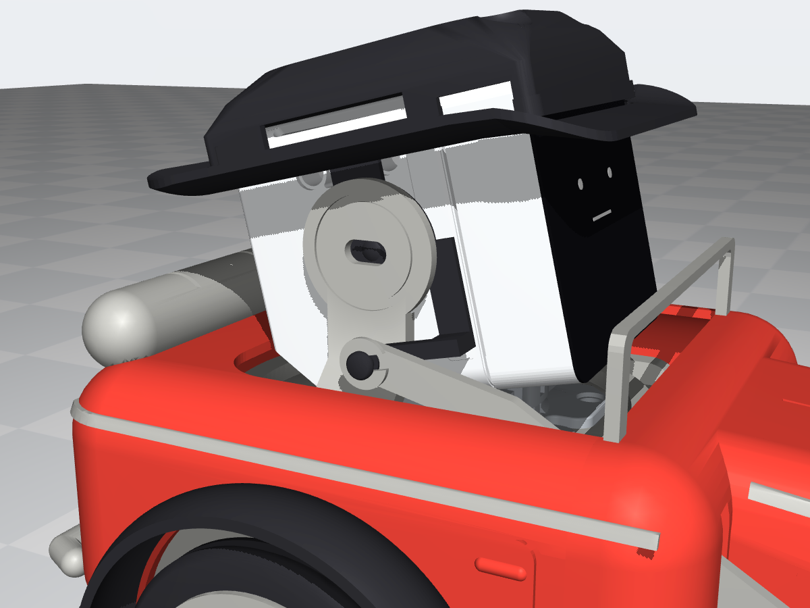

# スタックチャン・レトロカー(改造)

スタックチャンのサーボ 2 個で走る車です。首振りサーボを回し続けて後輪を回し、うなずきサーボで前輪の向きを変えます。
赤いボディに黒いフェンダーとタイヤ、金物はグレー。頭には黒いハットをかぶせ、うなずきをハットの腕から取り出してかじを切ります。

駆動部(デッキ、ターンテーブル歯車、ソケット枠、ピニオン、スリーブ)は [Yeq6X/stackchan-strider](https://github.com/Yeq6X/stackchan-strider)(MIT License)の部品をそのまま使っています。

小さい 2 台目(チョロQ風 FIAT 500、全長 167 mm)は [README_CAR500.md](README_CAR500.md) にあります。

**実機ではまだ一度も組んでいません。** 形の干渉と、かじ取りの動きの計算までを確かめた段階です。


## 仕様

| 項目 | 値 |
|---|---|
| 大きさ(スタックチャン込み) | 全長 226 × 全幅 142 × 全高 143 mm |
| 質量(見積り) | 約 441 g(印刷部品 約 253 g) |
| 重心の高さ | 地面から約 72 mm。後輪に 84% の重さがかかる |
| 車輪 | 半径 30 mm。前後の車軸の間隔 105 mm |
| 駆動 | 首振りサーボ → 傘歯車(1:1)→ 後輪の六角シャフト |
| かじ取り | うなずき 0〜30° → 前輪 +30〜-30°(13° で直進) |
| 印刷部品 | 55 個(39 種)、PLA 3 色。接着剤は使わず、すべてはめ込み |

## かじ取りのしくみ



1. **ハットが頭と一緒にうなずく。** ハットは頭に前から差し込み、後ろの止め板で抜けを止めます。
2. **左右の耳当てが位置を決める。** 耳当てはヨークの丸いパッドと同じ中心の円板で、頭とパッドの間に挟まります。中心がうなずきの軸なので、うなずいても位置は変わりません。耳当ての外側の小さな出っぱりが、パッドの長穴に落ちてハットの浮きを止めます。
3. **右の腕のピン J が前後に動く。** J はうなずきの軸の 18 mm 下にあり、うなずくと主に前後へ動きます。
4. **引き棒が右前輪を回す。** J から引き棒で、右前輪のナックルの内向きの腕(ドラッグアーム)を押し引きします。
5. **タイロッドが左前輪も同じ角度で回す。** 左右のナックルの前向きの腕とタイロッドで平行四辺形を作っています。

CoreS3 の横と下はハットで覆っていないので、ボタンや USB に手が届きます。

## 印刷

| ファイル | 中身 |
|---|---|
| `print_car/stackchan_car.3mf` | Bambu Studio のプロジェクト(P2S 用)。色とサポートの要否で分けた 5 枚のプレート |
| `print_car/stl/` | 部品ごとの STL。造形時の向きで置いてある。ファイル名の末尾が個数 |
| `print_car/parts.json` | 部品表(大きさ、体積、張り出しの面積、向き、サポートの要否) |

- **プリンター:** Bambu Lab P2S(ベッド 256 mm 角)、0.4 mm ノズル、0.20mm Standard、Bambu PLA Basic。設定は Bambu Studio 02.09.01.70 で P2S を選んで保存したプロジェクトのものを、そのまま使っています(`car/bambu_p2s_settings.json`)。
- **フィラメントの色:** 1 = グレー、2 = 赤、3 = 黒。
- **色ごとの体積:** グレー 193、黒 114、赤 71 cm³。
- **サポートが要る部品:** 側板、ナックル、ハット、引き棒、ホイールキャップ、ボディ前後、ボンネットのモール、ミラー、幌、ヘッドライト、グリル。
- **サポートは全体設定でオン、「重要な領域のみ」(ツリー、自動)。** サポートの要る部品は名前に `support` と付くプレートにまとめ、部品どうしを約 20 mm 空けています。それ以外のプレートは約 12 mm です(`car/build_car.py` の `PLATE_GAP`)。自動ブリム(最大 5 mm)が両隣の部品から伸びても重ならない幅で、5 mm にしていたときは Bambu Studio で「パスの競合」の警告が出ました。ハットだけは 1 枚を使わないよう、黒のプレートに載せています(`PLAIN_PLATE`)。

| プレート | 中身 |
|---|---|
| Gray 1 | デッキ、ヨーク、横棒、タイロッド、バンパー、ボディ横のモール、風防、C クリップほか 20 個 |
| Gray 2 | ターンテーブル歯車、ソケット枠 |
| Gray support | 側板、ナックル、引き棒、幌、グリル、ヘッドライト、ミラー、ボンネットのモール |
| Red support | ボディ前後、ホイールキャップ |
| Black | 前輪・後輪(ホイールとタイヤの一体)、ハット、フェンダー、ハットの止め板 |
- **前のボディは、後ろ端の舌(長さ 6 mm)で立つ。** 舌のまわりの切り口の下にはサポートを付けてください。
- **純正プリセットを自分で組み立てた設定では、Bambu Studio で開けなかった(「ジオメトリーがない」)。** Studio が保存時に足す項目が欠けていたためです。今の 3MF は Studio が保存した設定を使っていて、開けることを確認済みです。
- **ホイールとタイヤは一体で印刷する。** PLA は硬く、別々に印刷したタイヤはホイールにはめられないためです。
  - タイヤの角は 45° で落とし、O リングの溝も V 字にしました。どちらの面を下にしても、浮いた張り出しはありません。
  - 皿の飾りの穴はなくしました。橋の上で糸を引き、スパゲティ状になりやすいためです。
  - サポートは要りません。皿の下面は、リムとハブの間の幅 11 mm の橋になります。

## 印刷しない部品

| 部品 | 個数 | 用途 |
|---|---|---|
| スタックチャン(CoreS3、サーボ SCS0009 × 2) | 1 | 本体。首振りとうなずきのサーボを使う |
| O リング(太さ 2 mm、内径 55〜57 mm 程度) | 4 | 任意。タイヤの V 溝(底の直径 58 mm)にはめて滑り止めにする |

## 組立の順番

1. **駆動部を組む。** ピニオンとスリーブを六角シャフトに通し、左右の側板・デッキ・ヨークを組みます。ターンテーブル歯車とソケット枠も含め、順番と角穴・ツメの留め方は walker の吊り下げ版と同じです(`README_UNDERSLUNG.md`)。
2. **後輪を付ける。** ホイール(タイヤと一体)を六角シャフトの端に押し込み、ホイールキャップを差します。六角穴は外寄りの 6 mm だけ軽い圧入です。元の Strider で抜けやすかった点への対策です。
3. **前の横棒とナックルを付ける。** 横棒を側板の前の溝に上から落とします。ナックルのキングピンを横棒のボスに上から通し、下で C クリップを留めます。
4. **タイロッドと前輪を付ける。** タイロッドを左右のナックルの前向きのピンに通し、C クリップで留めます。前輪を軸に差し、ホイールの中で C クリップを留めて、ホイールキャップを差します。
5. **前のフェンダーを付ける。** フェンダーの内側の下向きのツメを、ナックルの支柱の上の台の角穴に押し込みます。
6. **前のボディを付ける。** ボンネットの内側の左右のツメを、横棒の角穴の上に合わせて押し下げます。ツメは横棒と側板の台の床を貫き、返しが側板の下に掛かります。これで横棒も上へ抜けなくなります。
7. **前のバンパーを付ける。** ボンネットの下に腕を通し、腕の先のツメを横棒の前の面の角穴に押し込みます。
8. **後ろのボディをかぶせる。** 前のボディの後ろ端の舌が、後ろのボディの内側に入るように下ろします。横の壁の内側の出っぱり 4 個が、側板の台の穴にカチッと落ちます。
9. **後ろのバンパーと後ろのフェンダーを付ける。** バンパーは、腕の先のツメをボディの背面の角穴へ押し込みます。フェンダーは、内側の縁のピン 3 本を、横の壁の穴へ押し込みます。
10. **ハットをかぶせる。** スタックチャンの頭に前から差し込みます。後ろの止め板を、横の壁の溝へ下から差します。
11. **ファームウェアでうなずきを制限する。** 次の「ファームウェア」を参照。引き棒を付ける前に済ませます。
12. **スタックチャンを載せる。** 運転席の開口から真上に下ろし、土台をソケット枠にはめます。頭はヨークのパッドの間に入ります。パッドが少し開いて耳当てを挟み、出っぱりがパッドの長穴に落ちます。ボディを付けたまま下ろせることは計算で確かめました。
13. **引き棒を付ける。** ハットの腕のピン J とドラッグアームのピンに通し、それぞれ C クリップで留めます。
14. **飾りを差す。** 次の部品を差し込みます。
    - 風防: 下のピン 2 本をカウルの穴へ。
    - 幌: 甲板のピン 2 本にかぶせる。
    - モール: ボディの溝に押し込む。横のモールは前後のボディの継ぎ目をまたぐ。
    - グリル、ヘッドライト、ミラー: ボディの穴へ。

ボディを外すときは、後ろのボディを真上に引き上げます(出っぱりが外れます)。前のボディは、側板の下から 2 本のツメの返しを内側へつまむと外れます。

## はめ込みの固さを変えるとき

| 症状 | 変える定数(`car/car_design.py`) | 初期値 |
|---|---|---|
| ピン(風防・幌・フェンダー後ろ・ミラー)、グリル、ヘッドライトが固い・緩い | `PRESS_FIT`(穴の半径すきま) | 0.05 mm |
| スナップのツメが入らない・抜ける | `SNAP_CLEAR`(角穴のすきま)。返しの大きさは walker の `SNAP_BARB` | 0.2 mm |
| 後ろのボディの出っぱりが固い・外れる | `DETENT["h"]`(出っぱりの高さ) | 0.7 mm |
| モールが溝に入らない | `MOLDING_KEY`(溝の深さ)。幅は溝と同じ(すきま 0) | 0.6 mm |

## ファームウェア

[firmware/README.md](firmware/README.md) の車用ファームウェアを書き込みます。

- **操作:** スマホのブラウザに出るジョイスティック 1 本。上下で前進・後退(倒すほど速い)、左右でかじ。BLE のゲームパッドの左スティックでも操作できます(Bluetooth Classic のパッドは不可)。
- **首振り:** 回し続けて後輪を回します。
- **うなずきは 0〜30° に必ず制限する。** ファームウェアが制限します。35° で前輪が -38°、45° で -51° まで切れ、引き棒やフェンダーが当たります。
- **直進は約 13°。** 0° で左いっぱい(+30°)、30° で右いっぱい(-30°)です。操作ページの設定で「レトロカー」を選び、まっすぐ走らなければ微調整します。

## 確認してほしい点

1. **うなずきの軸の高さ。** 実機の写真から、机の面から約 45 mm と読みました(±1.5 mm)。walker の推定値 43 mm より高いです。1.5 mm ずれると、端での切れ角が約 ±5° 変わります。ファームの上限角で合わせてください。
2. **はめ込みは実物で試していない。** 固さは上の表の定数で調整してください。後ろのボディの出っぱりは、横の壁が約 1 mm たわんで入る計算です。
3. **前のバンパーの腕が、ボンネットの下に少し見える。** 横棒まで約 40 mm の腕で留めているためです。
4. **かじの遊び。** ピンと穴のすきま 0.15 mm とハットの横のすきまで、前輪の切れ角に約 ±4.8° の遊びが出る計算です。
5. **前輪にかかる重さは 16%。** 前輪が滑ってかじが効きにくい場合は、O リングを付けてください。
6. **ナックルのピンは寝かせて印刷する。** 丸が少し楕円になるので、C クリップのはまり具合を確かめてください。
7. **ボンネットのモールは細い(0.8 × 2 mm)。** ベッドへの接地が線なので、サポートかブリムを付けてください。

## 作り直し方

```bash
.venv/bin/python car/verify_car.py
```

```bash
.venv/bin/python car/render_car.py
```

```bash
.venv/bin/python car/build_car.py
```

プリンターの設定を取り替えるときは、Bambu Studio で目的の設定を選んで保存した 3MF を渡します。

```bash
.venv/bin/python car/build_car.py --reference path/to/saved.3mf
```

| スクリプト | 内容 |
|---|---|
| `car/car_design.py` | 形。座標は Strider と同じ(X = 右、Y = 前、Z = 上、原点は後輪の車軸) |
| `car/verify_car.py` | 部品どうしの干渉(車軸 1 周 × うなずき 0〜30°)、質量、重心 |
| `car/render_car.py` | MuJoCo で描いた画像 → `out/car/views/`(`--pitch` でうなずきの角度) |
| `car/build_car.py` | 造形時の向きの STL と 3MF → `out/car/` と `print_car/` |
