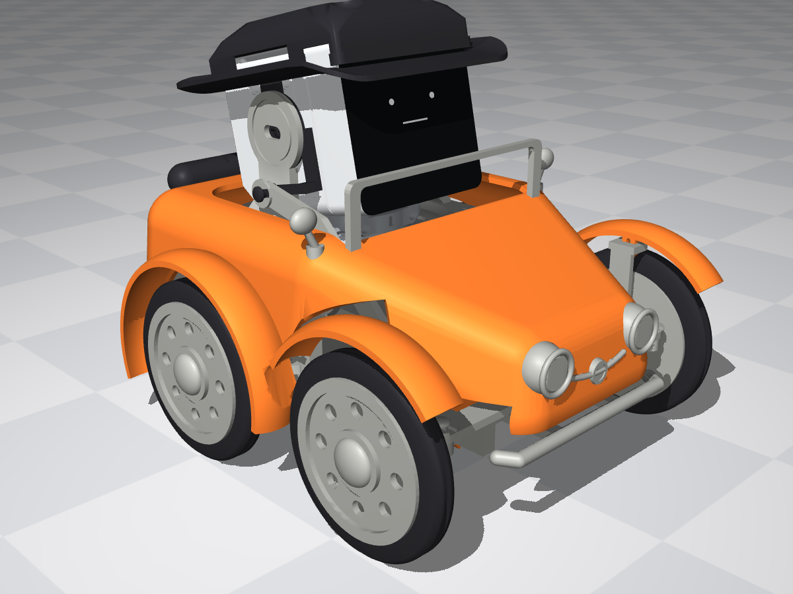
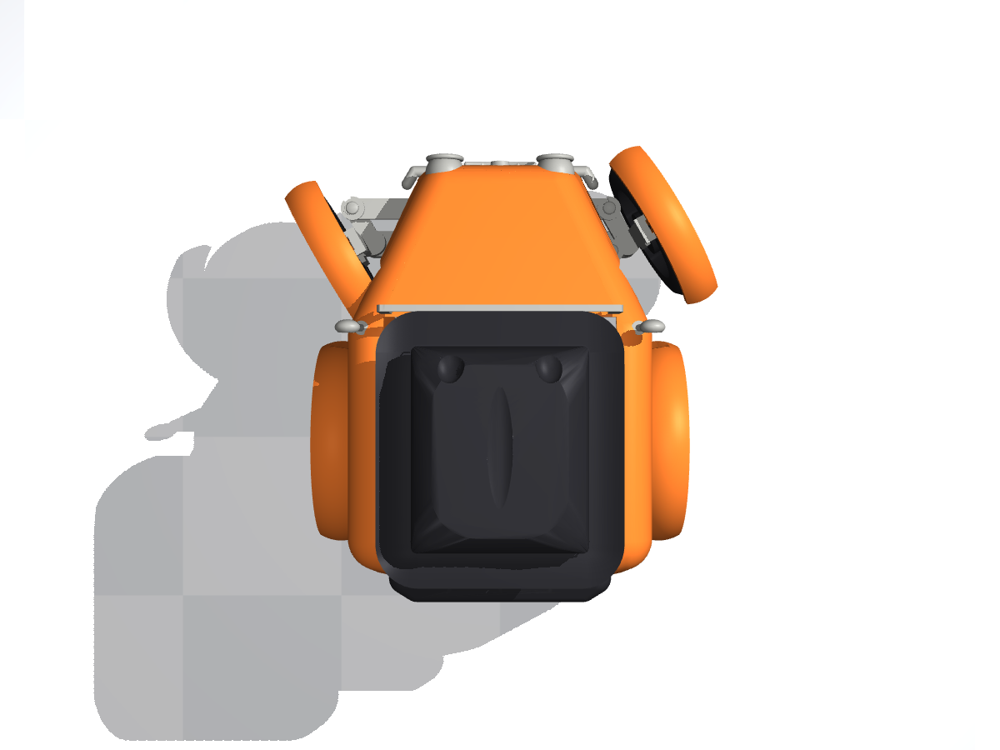
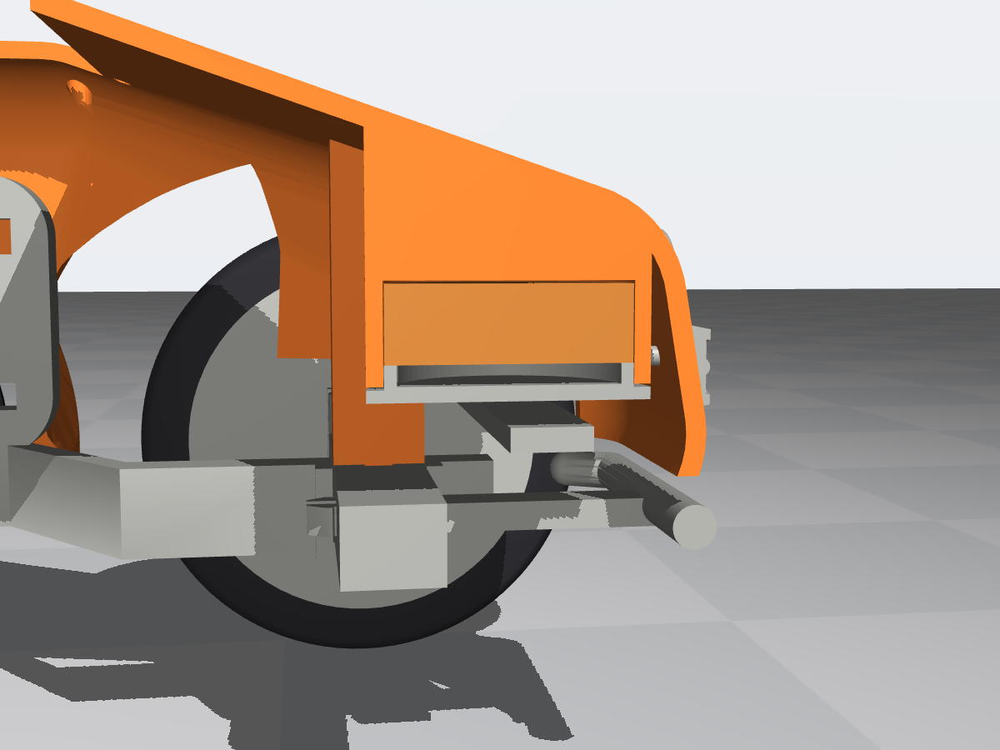
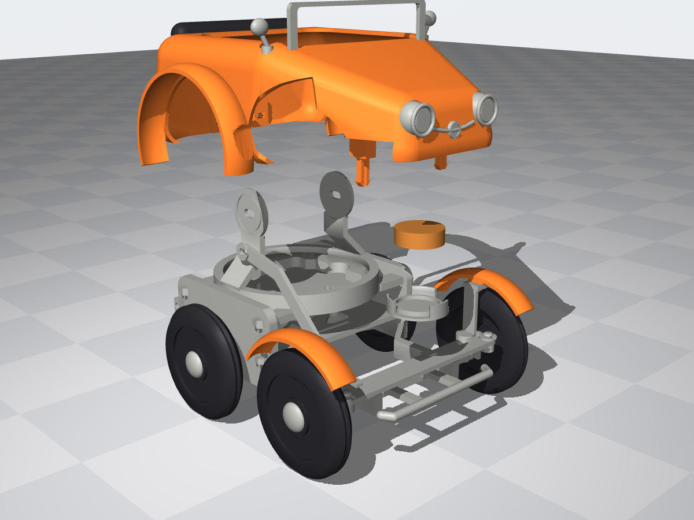
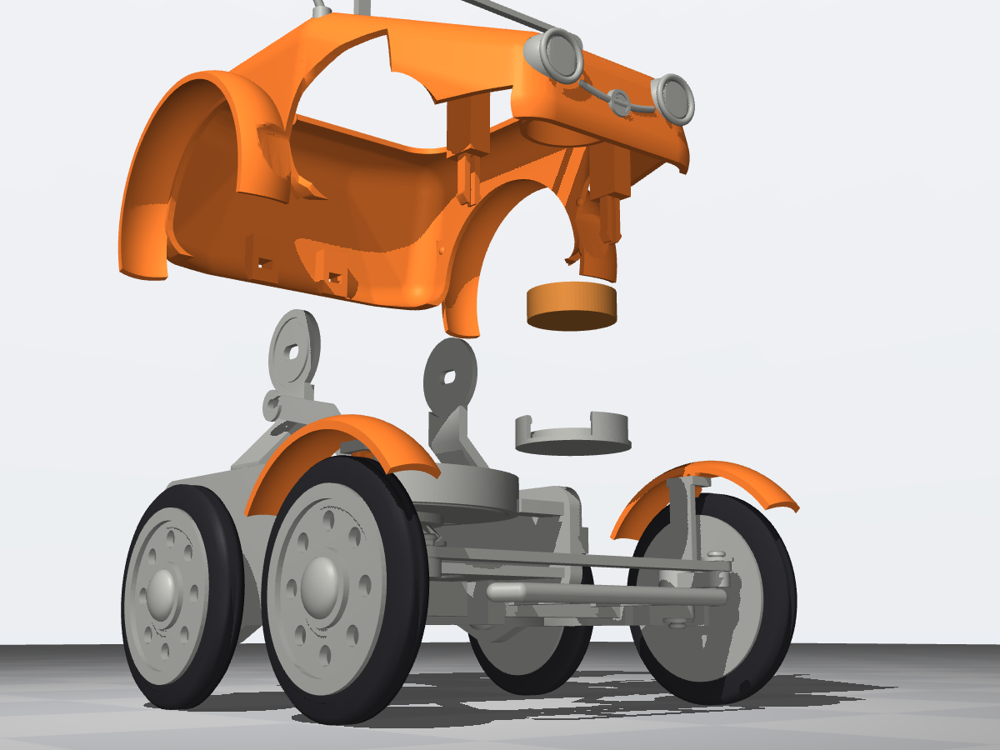

# スタックチャン・チョロQ風 FIAT 500(改造)

[レトロカー](README_CAR.md)を小さくした 2 台目です。走り方は同じです。
- 首振りサーボを回し続けて後輪を回す。
- うなずきサーボでハットの腕を前後に動かし、前輪の向きを変える。

変えたのは次の 2 点です。
- 前後の車軸の間隔を 105 mm から 78 mm に縮めた。
- 長いボンネットの代わりに、丸い鼻の 1 体の殻をかぶせた。

上はキャンバストップを開けた形で、そこからハットをかぶったスタックチャンの頭が出ます。

駆動部(デッキ、ターンテーブル歯車、ソケット枠、ピニオン、スリーブ)は [Yeq6X/stackchan-strider](https://github.com/Yeq6X/stackchan-strider)(MIT License)の部品です。かじ取りと足まわりはレトロカーの部品を使っています。

**実機ではまだ一度も組んでいません。** 形の干渉、かじ取りの動き、重さの配分の計算までを確かめた段階です。



## 仕様

| 項目 | 値 | レトロカー |
|---|---|---|
| 大きさ(スタックチャン込み) | 全長 167 × 全幅 142 × 全高 143 mm | 226 × 142 × 143 mm |
| 前後の車軸の間隔 | 78 mm | 105 mm |
| 質量(見積り) | 約 433 g(印刷部品 約 223 g、おもり 22.5 g) | 約 441 g |
| 重心の高さ | 地面から約 72 mm | 約 72 mm |
| 前輪にかかる重さ | おもりあり 20%、おもりなし 15% | 16% |
| かじ取り | うなずき 0〜30° → 前輪 +30〜-30°(12.6° で直進) | 同じ |
| 印刷部品 | 49 個(33 種)、PLA 3 色(グレー・オレンジ・黒)。接着剤は使わず、すべてはめ込み | |

## 前輪に重さをかけるおもり

重さのほとんどは、後ろの駆動輪の真上にあります。スタックチャンだけなら、駆動輪の車軸の 2 mm 前です。前輪が軽いと滑って、かじが効きません。

そのため、鼻の中に 10 円玉を入れる筒を作りました。実車でスペアタイヤが入っている場所です。
- 筒には 10 円玉を 5 枚(22.5 g)まで重ねて入れられます。
- 筒の下から 10 円玉を入れ、ふたを押し込みます。ふたのツメ 3 本の返しが、筒の外壁の溝にカチッと掛かって留まります。
- 10 円玉を 5 枚入れると、前輪にかかる重さは 15% から 20% に上がります。
- 前輪が滑るときは、枚数を増やす代わりに O リングを付けてください。筒は 5 枚分の深さしかありません。





| 部品 | 形 |
|---|---|
| 筒 | 殻と一体。内径 23.7 mm(10 円玉は直径 23.5 mm)、壁 1.6 mm。上は閉じていて、深さは 10 円玉 5 枚分(7.5 mm)。外壁の下寄りに、ふたの返しが掛かる溝(深さ 0.5 mm)が 1 周ある |
| ふた | 直径 29.7 mm のつば(厚さ 1.2 mm)。中に筒の真ん中へ合わせる差し込みの輪(長さ 2 mm)、外周に筒の外へ立つツメ 3 本(幅 50°、厚さ 1.2 mm、長さ 6 mm)。ツメの先に内向きの返し(掛かり 0.3 mm、上は面取り) |

ツメを筒の中でなく外に立てたのは、筒の中が 10 円玉で埋まり、ツメが内側へたわむすきまがないためです。

## 分解図

上から順に、殻と飾り、10 円玉、おもりのふた、車台です。組むときは下から重ねます(スタックチャンとハットは省略)。





## 印刷

| ファイル | 中身 |
|---|---|
| `print_car500/stackchan_car500.3mf` | Bambu Studio のプロジェクト(P2S 用)。設定はレトロカーと同じ `car/bambu_p2s_settings.json` |
| `print_car500/stl/` | 部品ごとの STL。造形時の向きで置いてある。ファイル名の末尾が個数 |
| `print_car500/parts.json` | 部品表(大きさ、体積、張り出しの面積、向き、サポートの要否) |

- **フィラメントの色:** 1 = グレー、2 = オレンジ、3 = 黒。
- **色ごとの体積:** グレー 189、黒 73、オレンジ 66 cm³。
- **サポートは全体設定でオン、「重要な領域のみ」(ツリー、自動)。** 名前に `support` と付くプレートは部品どうしを約 20 mm、それ以外は約 12 mm 空けています(自動ブリムどうしが重なって「パスの競合」にならない幅)。

| プレート | 中身 |
|---|---|
| Gray 1 | 歯車、ソケット枠、ヨーク、ホイール、横棒、バンパー、風防の枠、おもりのふた、C クリップほか 23 個 |
| Gray 2 | デッキ、前のホイール 1 個 |
| Gray support | 側板、ナックル、引き棒、ヘッドライト、ホイールキャップ、鼻のモール、ドアミラー |
| Orange support | 殻、前のフェンダー |
| Black | ハット、タイヤ、たたんだキャンバストップ、ハットの止め板 |

- **殻は後ろの面を下にして立てて印刷する(高さ 159.5 mm)。** 中にサポートが付きます。丸い背面を 1.5 mm 平らに削った面(約 2,900 mm²)がベッドに着きます(`REAR_FLAT`)。丸いままでは幅 2 mm の線でしか接地せず、すぐ上の浮いた面に「サポートを生成できない」警告が出ました。
- **鼻のひげ形のモールは細い(太さ 1.8 mm)。** 表を下にして印刷するので、サポートかブリムを付けてください。

## 印刷しない部品

| 部品 | 個数 | 用途 |
|---|---|---|
| スタックチャン(CoreS3、サーボ SCS0009 × 2) | 1 | 本体。首振りとうなずきのサーボを使う |
| 10 円玉 | 5 | 鼻のおもり(4.5 g × 5) |
| O リング(太さ 2 mm、内径 55〜57 mm 程度) | 4 | 任意。タイヤの溝にはめて滑り止めにする |

## 組立の順番

1. **駆動部、後輪、前の横棒とナックル、タイロッドと前輪を組む。** レトロカーの手順 1〜4 と同じです([README_CAR.md](README_CAR.md))。
2. **前のフェンダーを付ける。** 内側の下向きのツメを、ナックルの支柱の上の台の角穴に押し込みます。
3. **殻におもりを入れる。** 殻を裏返し、鼻の中の筒に 10 円玉を重ねます。ふたを筒にかぶせて押し込み、3 本のツメがカチッと掛かるまで入れます。
   - 外すときは、ツメを 1 本ずつ外へ広げて返しを溝から外します。
   - ふたは、殻を車に付けると横棒とタイロッドに隠れて手が届きません。殻を付ける前に入れてください。
4. **殻をかぶせる。** 真上から下ろします。
   - 鼻の内側の左右のツメが、横棒の角穴と側板の台の床を貫きます。返しは側板の下に掛かります。
   - 横の壁の内側の出っぱり 4 個が、側板の台の穴にカチッと落ちます。
5. **前後のバンパーを付ける。**
   - 前: 鼻の下に腕を通し、腕の先のツメを横棒の前の面の角穴に押し込みます。
   - 後ろ: 腕の先のツメを、殻の背面の角穴に押し込みます。
6. **ハットをかぶせ、ファームウェアでうなずきを 0〜30° に制限する。** レトロカーの手順 10〜11 と同じです。
7. **スタックチャンを載せる。** 上の開口から真上に下ろし、土台をソケット枠にはめます。殻と飾りを付けたまま下ろしても当たらないことは、計算で確かめました。
8. **引き棒を付ける。** ハットの腕のピン J とドラッグアームのピンに通し、それぞれ C クリップで留めます。
9. **飾りを差す。** 次の部品を差し込みます。
   - ヘッドライト、鼻のモール: 鼻の穴へ。
   - 風防の枠、ドアミラー: 殻の上面の穴へ。
   - たたんだキャンバストップ: エンジンフードの上のピン 2 本にかぶせる。

殻を外すときは、側板の下から 2 本のツメの返しを内側へつまみ、真上に引き上げます。

## はめ込みの固さを変えるとき

レトロカーと同じ定数を使っています(`car/car_design.py`。表は [README_CAR.md](README_CAR.md) を参照)。

## ファームウェア

レトロカーと同じです。うなずきは必ず 0〜30° に制限してください。直進は約 12.6° です。

## 確認してほしい点

1. **前輪が滑らないか。**
   - 前輪にかかる重さは、おもりありで 20%、なしで 15%(計算値)。スタックチャンの重心の位置は仮定です(土台の底から 40 mm 上、4 mm 前)。
   - 滑るときは、O リングを付けてください。
2. **前のフェンダーと側板のすきまは小さい。**
   - 前輪を 30° 切ったときにすきまが残る、最小に近い間隔で作りました(76 mm では当たる)。
   - フェンダーがたわむと側板に触れるかもしれません。
3. **はめ込みと、うなずきの軸の高さ。** レトロカーの確認点 1、2 と同じです。
4. **殻は 1 体で大きい。** 印刷の時間とサポートの量を、Bambu Studio で確かめてください。

## 作り直し方

```bash
.venv/bin/python car/verify_car.py --model car500
```

```bash
.venv/bin/python car/render_car.py --model car500
```

```bash
.venv/bin/python car/build_car.py --model car500
```

```bash
.venv/bin/python car/render_car500_explode.py
```

| スクリプト | 内容 |
|---|---|
| `car/car500_design.py` | この車の形。`car_design.configure()` で車軸の間隔を変え、駆動部・かじ取り・足まわりはレトロカーの部品を使う |
| `car/render_car500_explode.py` | 分解図と鼻の断面図 → `docs_car500/`(`render_car.py` の描き方を使い、部品の置き方だけ変える) |
| `car/model_select.py` | 3 つのスクリプトの `--model` で、レトロカー(`car`)とこの車(`car500`)を選ぶ |
