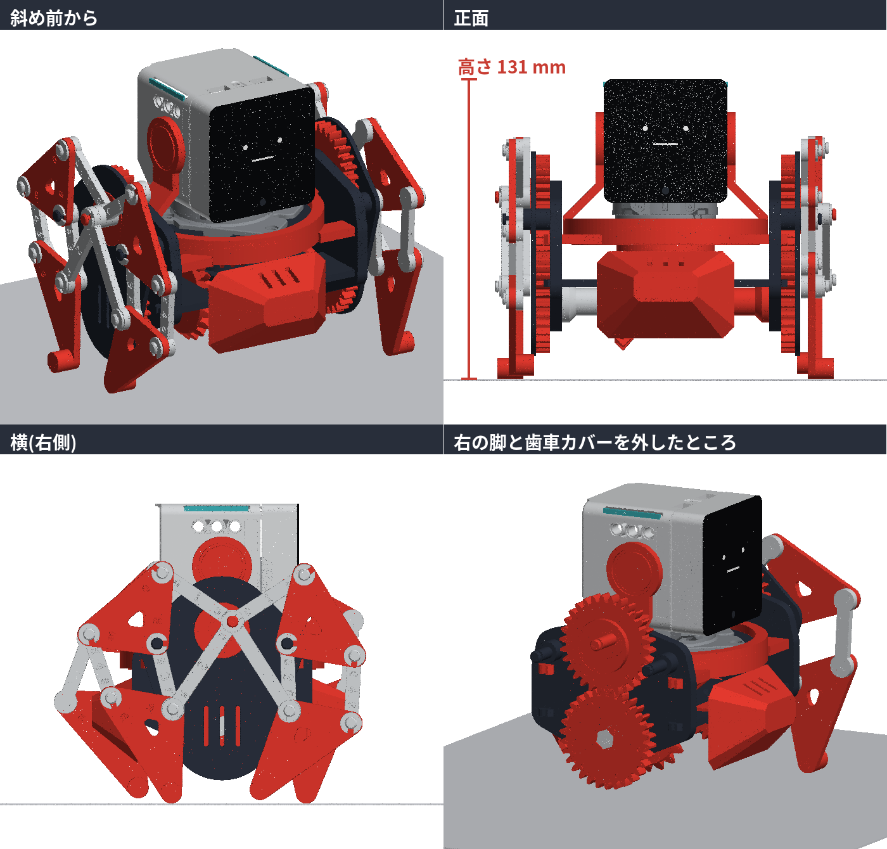

# Stackchan Strider 吊り下げ版(改造)

[Yeq6X/stackchan-strider](https://github.com/Yeq6X/stackchan-strider)(MIT License)を元にした改造です。
元の設計は Yeq6X さんのもので、このフォルダの `README.md`、`firmware/`、`refs/`、`print/` は元のままです。
改造したのは `walker/` のコードと、そこから出力した `print_underslung/` です。

**実機ではまだ一度も組んでいません。** 形状の干渉・組立手順・物理シミュレーションの検証までです。



## 何を変えたか

| | 元の設計 | 吊り下げ版 |
|---|---|---|
| 全高(スタックチャン込み) | 180 mm | 131 mm |
| 全幅 | 96 mm | 149 mm |
| 全長 | 147 mm | 147 mm |
| 重心の高さ(見積り) | 約 124 mm | 約 77 mm |
| 質量(見積り) | 約 297 g | 約 357 g(印刷部品 約 170 g) |
| 印刷部品 | 57 個(16 種) | 63 個(19 種) |
| 動力 | 首振りサーボ 1 個 | 同じ |

1. **胴体を脚の間に吊り下げた。** 駆動軸(傘歯車のピニオンが載る六角シャフト)は胴体の下に残し、脚のクランク軸だけを 42 mm 上へ移した。
2. **平歯車を左右に 2 枚ずつ追加した。** シャフトの端の平歯車が、クランクと一体の平歯車を 1:1 で回す(モジュール 1.4、30 歯)。
3. **クランクは側板の短軸で回る。** 胴体があるのでシャフトを通せないため、左右のクランクは別々の短軸に止まり穴でかぶせる。
4. **歯車カバーを追加した。** 固定ピボット B の突起に通す板で、平歯車が外へ抜けるのと傾くのを止める。
5. **側板をカラーの外側へ出した。** デッキもヨークも、横向きのスナップのツメで側板の角穴に留める。
6. **ピニオンとスリーブにつばを付けた。** 傘歯車が押し返す力を、側板の内面で受ける(元の設計では右クランクと脚が受けていた)。
7. **前後にカウル(外装)を追加した。** デッキの端に差し込むだけで、付けなくても歩ける。

脚のリンク、三角板、C クリップ、ソケット枠の 47 個は、元の STL と同じ形です。

## 確認してほしい点

1. **前進と後退が逆になる。** 平歯車で回転の向きが 1 回反転する。ファームウェアの操作ページの「設定 → 前進と後退を入れ替える」にチェックを入れる。
2. **平歯車の噛み合いの固さ。** 歯面のすきまは片側 0.19 mm で設計した。固ければ `walker/design.py` の `SPUR_BACKLASH`(初期値 0.2)を増やして出力し直す。
3. **クランク歯車の止まり穴の天井。** 直径 10 mm の橋渡しで造形される。垂れて短軸の先に当たるようなら、天井を軽く削るか `STUB_LEN` を短くする。
4. **3MF のプリンター設定。** `print_underslung/stackchan_strider_underslung.3mf` は、元の配布 3MF(Bambu Lab A1 mini 用)の設定を流用している。Bambu Studio で開いてプリンターを切り替える。Bambu Studio での読み込みは確認していない。開けない場合は `print_underslung/stl/` の STL を使う(ファイル名の末尾が個数)。
5. **地面とのすきまは約 10 mm。** 一番低いのは歯車カバーの下端。平らな机や床の上が前提なのは元と同じ。
6. **分解しにくくなった。** ヨークが横向きのツメで側板に留まるので、ターンテーブルを外すには側板を片方外す必要がある。
7. **ファームウェアの書き込み。** 元の `firmware/README.md` のとおり、書き込むと今入っているアプリは起動しなくなる。先にフラッシュ全体を読み出して保存しておく。

## 印刷

元の設計と同じ条件です(0.4 mm ノズル、積層 0.2 mm、PLA、サポートなし)。最大の部品は 107 × 89 mm(ヨーク)。

| 区分 | 部品(ファイル名) | 個数 |
|---|---|---|
| 新規 | `spur`(シャフトの平歯車) | 2 |
| 新規 | `cover`(歯車カバー) | 2 |
| 新規 | `cowl`(前後のカウル) | 2 |
| 作り直し | `side_plate`、`crank`(クランク歯車) | 各 2 |
| 作り直し | `deck`、`yoke`、`gear_table`、`pinion`、`shaft`、`sleeve` | 各 1 |
| 元と同じ | `link_j`・`link_k`・`link_c`・`link_f`、`tri_upper`、`tri_lower` | 各 4 |
| 元と同じ | `clip` | 22 |
| 元と同じ | `socket_frame` | 1 |

造形の向きは STL に反映済みです。気をつける部品は次の 3 つです。

- `crank`: 止まり穴を下、ピンを上。穴の天井が橋渡しになる。
- `pinion`: 背面を下、筒を上。高さ 73 mm の細い筒が立つ。
- `cowl`: 鼻先を下、舌を上。舌の間に 3.3 mm の橋渡しが 1 か所ある。

## 試し刷り(平歯車の固さと、クランク歯車の止まり穴)

全部を刷る前に、右側の駆動まわりだけを刷って手で回す。

```bash
python walker/build_test_fit.py --backlash 0.2,0.3
```

`out/test_fit/` に次の STL が出る(向きは造形時の向きのまま。条件は本番と同じ)。合計 約 70 cm³。

| ファイル | 個数 | メモ |
|---|---|---|
| `side_plate.stl`、`sleeve.stl`、`shaft.stl`、`cover.stl` | 各 1 | 本番と同じ形 |
| `spur_bl0.20.stl`、`crank_bl0.20.stl` | 各 1 | 設計値。本番の STL と同じもの |
| `spur_bl0.30.stl`、`crank_bl0.30.stl` | 各 1 | 歯厚をさらに 0.1 mm 減らしたもの(固かったとき用) |

0.20 と 0.30 は見た目では区別できないので、別のプレートに分けるか、刷ったらすぐに袋を分ける。

設計上のすきま(形状で計算した値): 平歯車の遊びはピッチ円上で合計 0.41 mm(0.20)と 0.61 mm(0.30)。1 歯ぶん回して干渉はない。クランク歯車の止まり穴と短軸の半径すきまは 0.2 mm、短軸の先と穴の天井は 0.6 mm、側板の外面とクランクの内面は 0.2 mm。

組み方(右側):

1. スリーブを、側板の下の穴に内側から通す(つばが内側)。
2. 六角シャフトをスリーブに通し、外側の端に平歯車を差す(くぼみの印が外向き)。
3. クランク歯車を短軸にかぶせ、平歯車の真上のくぼみとクランク歯車のくぼみを向かい合わせる。
4. 歯車カバーを固定ピボット B の 2 本の突起に通す。座の高いほうを突起の長いほう(右は前)に合わせ、指で押さえる。

見ること:

| 確認 | 合格の目安 | だめなとき |
|---|---|---|
| クランク歯車が短軸の根元まで入るか | 側板との間がほぼ無い(設計 0.2 mm) | 天井が垂れて短軸の先に当たっている。天井を削るか、`STUB_LEN` を短くする |
| カバーなしで、シャフトを指で回す | 1 回転のどこでも引っかからず、軽く回る | 0.30 の組で試す。それでも固ければ、歯の側面の太りを疑う |
| カバーを押さえて回す | カバーなしと固さがほぼ変わらない | 歯車の面とカバーがこすれている。`SPUR_FACE_GAP` を増やす |
| クランク歯車のぐらつき | カバーを押さえるとピンが倒れない | カバーの厚みか座の高さを見直す |

0.30 のほうが良ければ、`walker/design.py` の `SPUR_BACKLASH` を 0.3 にして `build.py` と検証を流し直す。
歩くときはクランク 1 回転で脚が 1 周するので、遊びが増えても歩幅は変わらない。左右のピンの 180° のずれが遊びのぶん(0.30 で約 ±0.8°)ずれるだけ。

## 組み立て(元の手順から変わるところ)

1. ピニオンの筒を、**左の側板の下の穴に内側から**通す(つばが内側に残る)。デッキとヨークの左のツメを、左の側板の角穴に押し込む。
   ヨークを付ける前に、ターンテーブル歯車の軸をデッキの筒に落とし、ソケット枠を載せておく。
2. スリーブを、**右の側板の下の穴に内側から**通す(つばが内側)。右の側板を、デッキとヨークの右のツメに押し込む。
3. 六角シャフトを端から通し、両端に平歯車を差す(くぼみの印が外向き)。
4. クランク歯車を左右の短軸にかぶせる。**平歯車の印(真上のくぼみ)と、クランク歯車の印(くぼみ)を、左右とも向かい合わせる。**
   こうすると右のピンは前向き、左のピンは後ろ向きの水平になり、左右が 180° ずれる。
5. 歯車カバーを、固定ピボット B の 2 本の突起に通す(クランクの円板が穴から出る)。
   **座の高いほうを、側板の突起の長いほうに合わせる**(右は前、左は後ろ)。逆に付けると脚のクリップがはまらない。
6. 脚は元の組立ガイドのとおりに組む。
7. カウルを前後からデッキの端に差し込む(上の舌の山が、デッキの溝に落ちるまで)。
8. スタックチャンの土台を枠に、頭をパッドの間に入れる。

## 検証の結果

`walker/` の検証スクリプトを、改造後の形状でそのまま走らせた結果です。

- 傘歯車(`verify_gears.py`): 合格。
- 平歯車: 1 歯ぶん回して干渉なし、すきまは片側 0.19 mm で一定。片方だけ 2° 回すと干渉する(歯が噛んでいる)。
- 歩行 1 周(`verify_walk.py`、2° 刻み、スタックチャン込み): 干渉なし。連結していない部品の最小すきま 0.50 mm。
- 組立(`verify_assembly.py`): 左右 30 操作が合格(歯車カバーと平歯車を付けた状態で確認)。
- 接地姿勢: 常に 3 本以上で支え、傾きは最大 3.1°。静的な転倒角は 37°(元は 14°)。
- 物理シミュレーション(`sim_sweep.py`、MuJoCo 3.9): 24 条件すべてで転倒なし。サーボの平均トルクは最大 31 mN·m(定格 64 mN·m)。
  クランク軸の摩擦は、歯車と軸受けが増えたぶんとして元の 3 倍に仮定した。関節の摩擦をさらに 4 倍にした条件でも歩いた(平均 53 mN·m)。

モデルに入っていないもの: 平歯車の歯面の摩擦と遊び、クランク歯車の傾き、部品のたわみ、印刷の太り。
元の設計の README には「すきまを詰めた試作は摩擦で歩かなかった」とあり、歯車が増えたこの版はそれより条件が厳しい。

## 寸法を変える

`walker/design.py` の先頭にまとめてあります。

| 定数 | 意味 | 初期値 |
|---|---|---|
| `UNDERSLUNG` | 吊り下げ版にする(環境変数 `STRIDER_UNDERSLUNG=0` で無効) | 有効 |
| `SPUR_MODULE`、`SPUR_TEETH` | 平歯車の大きさ。ピッチ円直径がそのまま下げ幅になる | 1.4、30 |
| `SPUR_BACKLASH` | 歯厚の減らし量(歯車 1 枚あたり) | 0.2 |
| `SPUR_T` | 平歯車の歯幅 | 6.0 |
| `COVER_T` | 歯車カバーの厚み | 2.0 |
| `TABLE_LIFT` | 歯車の背面からターンテーブルまでの持ち上げ量 | 2.7 |
| `COWL_*` | カウルの寸法 | |

出力と検証の手順は元の README と同じです(`python walker/build.py` など)。
Bambu Studio が入っていない環境では、3MF のプロジェクト設定を `print/stackchan_strider.3mf` から借ります。

`docs_underslung/viewer.html` は元のビューアーを改造後の形状で出力したものですが、表示は確認していません。

## ライセンス

元の設計と同じ MIT License です(`LICENSE`、Copyright (c) 2026 Yeq6X)。
`refs/official_stl/` は M5Stack 公式の構造データ(MIT License)です。
